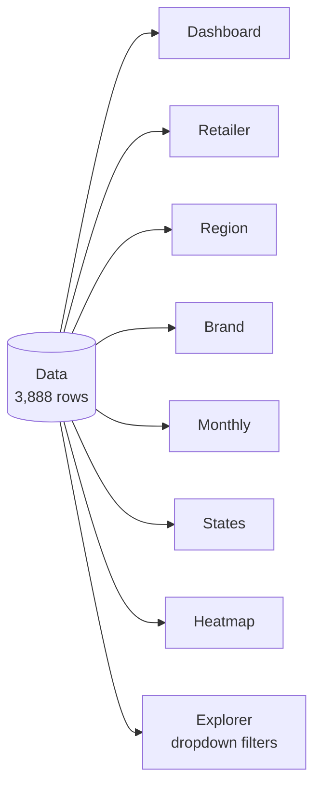

<div align="center">

# 🥤 Coca-Cola US Retail Sales Analysis

### Optimizing sales and profitability across retailers, regions and brands, built entirely in Microsoft Excel


</div>

---

## 📑 Table of Contents

1. [Project Overview](#-project-overview)
2. [Headline Numbers](#-headline-numbers)
3. [Dataset](#-dataset)
4. [Data Preparation](#-data-preparation)
5. [Workbook Structure](#-workbook-structure)
6. [Key Findings](#-key-findings)
7. [Recommendations](#-recommendations)
8. [Excel Techniques Used](#-excel-techniques-used)
9. [Data Quality Flags](#-data-quality-flags)
10. [Repository Contents](#-repository-contents)
11. [How to Use the Workbook](#-how-to-use-the-workbook)
12. [Author](#-author)

---

## 🎯 Project Overview

**Business question:**

> *How can Coca-Cola optimize sales and profitability across U.S. retailers?*

Selling more units is not enough in a competitive beverage market. The goal is to sell the **right products, in the right regions, through the right retailers, at a healthy margin**. This analysis looks at three things:

| # | Focus | Question answered |
|:-:|---|---|
| 1 | **Where** | How do sales vary by retailer, region, state and brand? |
| 2 | **When** | Is there a seasonal pattern in sales and margin? |
| 3 | **How well** | Where are margins strong, and where are they weak? |

---

## 📊 Headline Numbers

| 💰 Total Sales | 📈 Operating Profit | 🎯 Operating Margin | 📦 Units Sold |
|:-:|:-:|:-:|:-:|
| **$8.68M** | **$3.17M** | **36.5%** | **17.15M** |

> Margins throughout are **weighted** (Operating Profit ÷ Total Sales), not simple averages of row-level percentages, so large orders count in proportion to their size.

---

## 🗂 Dataset

| Property | Detail |
|---|---|
| **Source file** | `Coke-sales-analysis-stubs.xlsx` (kept untouched as the reference copy) |
| **Rows** | 3,888 invoice lines |
| **Period** | 1 Jan – 31 Dec 2021 |
| **Retailers** | 4 — Sodapop, FizzySip, BevCo, DreamCo |
| **Regions** | 5 — West, Northeast, Southeast, South, Midwest |
| **States** | 50 |
| **Brands** | 6 — Coca-Cola, Diet Coke, Sprite, Fanta, Powerade, Dasani Water |

**Columns**

| Column | Type | Notes |
|---|---|---|
| Retailer, Retailer ID | Text, ID | |
| Invoice Date | Date | |
| Region, State, City | Text | |
| Beverage Brand | Text | |
| Price per Unit | Currency | |
| Units Sold | Integer | |
| **Total Sales** | Formula | `= Price per Unit × Units Sold` |
| **Operating Profit** | Formula | `= Total Sales × Operating Margin` |
| Operating Margin | Percentage | |
| **Month** | Formula (added) | `= MONTH(Invoice Date)` |

---

## 🧹 Data Preparation

| Step | Result |
|---|---|
| Missing values | ✅ None |
| Duplicate rows | ✅ None |
| Data types | ✅ Dates are real Excel dates; numbers are numeric |
| Header row | 🧊 Frozen so headings stay visible |
| Filters | 🔽 Enabled on all columns |
| New column | ➕ `Month` added with `MONTH()`, which powers the monthly analysis |
| Source file | 🔒 Original stubs file left unchanged; all work done in the completed copy |

---

## 🧭 Workbook Structure



| Sheet | Purpose |
|---|---|
| **Dashboard** | KPI tiles, 7 charts and key insights |
| **Data** | Cleaned master table |
| **Retailer** | Units, sales, profit and margin per retailer, with 2 charts |
| **Region** | Same metrics per region, with 2 charts |
| **Brand** | Same metrics per brand plus average price, with 2 charts |
| **Monthly** | 12-month sales and margin trend, with 2 charts |
| **States** | 50-state table with margin colour scale |
| **Heatmap** | Region × Brand grids for sales and margin |
| **Explorer** | Interactive view: pick Retailer, Region and Brand from dropdowns |
| **Notes** | Methodology and data notes |
| *Sheet2* | Helper table used in the analysis |

---

## 🔍 Key Findings

### 1️⃣ Retailers: sales rank and margin rank are not the same

| Retailer | Units | Sales | Profit | Margin | Sales share | Avg price |
|---|--:|--:|--:|:-:|--:|--:|
| 🥇 **Sodapop** | 9,153,950 | $4,403,630 | $1,647,936 | 37.4% | **50.7%** | $0.48 |
| 🥈 **FizzySip** | 4,109,000 | $2,584,450 | $835,759 | 🔴 **32.3%** | 29.8% | $0.63 |
| 🥉 **BevCo** | 3,064,800 | $1,291,535 | $542,046 | 🟢 **42.0%** | 14.9% | $0.42 |
| **DreamCo** | 820,500 | $404,413 | $147,890 | 36.6% | 4.7% | $0.49 |
| **Total** | **17,148,250** | **$8,684,028** | **$3,173,632** | **36.5%** | **100%** | **$0.51** |

- **Sodapop** is the volume engine: about half of all sales at an above-average margin.
- **FizzySip** is the second-largest account and has the highest average price, yet the **lowest margin**. High volume does not mean high profit here.
- **BevCo** is small and sells at the lowest price, but earns the **highest margin**.

### 2️⃣ Regions: the biggest market is not the most profitable

| Region | Sales | Profit | Margin | Sales share |
|---|--:|--:|:-:|--:|
| **West** | $2,835,100 | $923,014 | 🔴 **32.6%** | 32.7% |
| **Northeast** | $1,788,348 | $629,546 | 35.2% | 20.6% |
| **Southeast** | $1,618,935 | $641,554 | 39.6% | 18.6% |
| **South** | $1,291,535 | $542,046 | 🟢 **42.0%** | 14.9% |
| **Midwest** | $1,150,110 | $437,472 | 38.0% | 13.2% |

The **West** brings in a third of all sales but has the thinnest margin. The **South** is smaller but the most profitable.

**State highlights**

| | States (value) |
|---|---|
| 🏆 **Top sales** | New York ($582.7K) · California ($582.4K) · Florida ($561.9K) · Texas ($441.0K) · Georgia ($292.2K) |
| 🟢 **Highest margin** | Alabama (51.5%) · Tennessee (46.4%) · Virginia (43.6%) · Louisiana (41.5%) · Kentucky (40.5%) |
| 🔴 **Lowest margin** | Alaska (25.5%) · Washington (25.8%) · Rhode Island (28.3%) · New Hampshire (30.4%) · Hawaii (30.5%) |

California is a large market whose profitability is below average, so it deserves attention.

### 3️⃣ Brands: Coca-Cola leads, Diet Coke lags

| Brand | Sales | Profit | Margin | Sales share | Avg price |
|---|--:|--:|:-:|--:|--:|
| 🥇 **Coca-Cola** | $2,015,890 | $793,197 | 🟢 **39.3%** | 23.2% | $0.49 |
| **Dasani Water** | $1,725,838 | $655,700 | 38.0% | 19.9% | $0.58 |
| **Diet Coke** | $1,481,425 | $494,318 | 🔴 **33.4%** | 17.1% | $0.49 |
| **Sprite** | $1,235,588 | $430,520 | 34.8% | 14.2% | $0.46 |
| **Powerade** | $1,193,638 | $427,072 | 35.8% | 13.8% | $0.56 |
| **Fanta** | $1,031,650 | $372,826 | 36.1% | 11.9% | $0.47 |

Price alone does not explain profit. Margin depends on the product and market mix, not only on how cheap or expensive a unit is.

### 4️⃣ Time: two seasonal peaks, flat margin

| Month | Sales | Margin | | Month | Sales | Margin |
|:-:|--:|:-:|-|:-:|--:|:-:|
| Jan | $510,750 | 35.9% | | Jul | **$1,041,438** 🔥 | 36.9% |
| Feb | $484,975 | 35.9% | | Aug | $945,275 | 37.0% |
| Mar | $483,530 | 36.1% | | Sep | $681,000 | 36.5% |
| Apr | $494,888 | 35.8% | | Oct | $623,375 | 36.3% |
| May | $673,573 | 36.9% | | Nov | $795,613 | 36.5% |
| Jun | $903,838 | 36.8% | | Dec | **$1,045,775** 🔥 | 36.7% |

- **Trough:** January to April, around $0.48–0.51M per month.
- **Peaks:** July (summer) and December (holidays), each about $1.04M.
- **Dip:** September and October fall back before the holiday rise.
- **Margin barely moves** (35.8%–37.0%), so the swings come from **volume, not profitability**. Promotions can be timed for the peaks without worrying about margin erosion.

---

## 💡 Recommendations

| # | Recommendation | Why |
|:-:|---|---|
| 1 | **Renegotiate pricing or trade terms with FizzySip and in the West** | High volume but the thinnest margins (32.3% and 32.6%) |
| 2 | **Grow BevCo and the South**, and study what makes Alabama and Tennessee so profitable | Best margins (42.0%); the practices can be copied elsewhere |
| 3 | **Time promotions and inventory around July and December**, and run offers to lift the Sep–Oct dip | Demand is strongly seasonal and margin holds steady |
| 4 | **Review Diet Coke and Sprite pricing or costs** | Weakest brand margins (33.4% and 34.8%) |
| 5 | **Validate the data anomalies** before acting on them | Zero-sale rows and identical Wyoming/Utah figures (see below) |

> **Biggest lever:** it is not simply selling more. It is improving the **mix** of retailers, regions and brands, and **timing** promotions to seasonality.

---

## 🛠 Excel Techniques Used

| Technique | Where it is used |
|---|---|
| `SUMIFS` | All retailer, region, brand, month and state totals, and the Explorer |
| `MONTH()` | Helper column for the monthly analysis |
| Weighted margin (`Profit / Sales`) | Every summary table |
| **Conditional formatting** (colour scales) | Margin columns and both Heatmap grids |
| **Data validation** (dropdowns) | Explorer filters |
| Charts (bar, column, line) | Dashboard and each analysis sheet |
| Freeze panes and filters | Data sheet |
| Live formulas | Dashboard KPIs update automatically from the Data sheet |

---

## ⚠️ Data Quality Flags

These were left as supplied so the totals tie back to the source, but they should be verified with the data owner.

| Flag | Detail |
|---|---|
| **Zero-sale rows** | `Units Sold` has a minimum of 0, so a small number of rows record no sales |
| **Wyoming and Utah are identical** | Both show exactly $199,937.50 in sales and $69,359.38 in profit |
| **South region = BevCo** | The South region and the retailer BevCo contain exactly the same rows |

---

## 📁 Repository Contents

```
Root/
├── 📄 README.md                                           ← You are here
├── 📗 Coke-sales-analysis-completed.xlsx                  ← Final analysis workbook
├── 📗 Coke-sales-analysis-stubs.xlsx                      ← Original reference file (unchanged)
```

---

## 🚀 How to Use the Workbook

1. Download and open **`Coke-sales-analysis-completed.xlsx`** in Microsoft Excel.
2. Let it finish calculating (press **F9** if any cell looks empty).
3. Start on the **Dashboard** sheet for the overview, then follow the tabs left to right.
4. Open the **Explorer** sheet and use the yellow dropdowns (Retailer, Region, Brand) to see sales, profit, margin and the monthly chart update. Set all three back to **All** to reset.

---

## 👤 Author

**Anuj Nagar**
Crio Data Analytics (DA-201) · Session 4 Assignment

---

<div align="center">

*If you found this useful, feel free to ⭐ the repository.*

</div>
